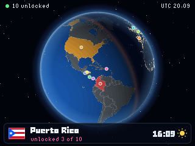

# Travel Globe

Travel Globe spins a 3D globe on your badge with every country you have visited unlocked in colour, live day and night, and city lights on the night side.

## Usage

The globe turns slowly on its own. Countries you have visited are drawn in
their own colours; the rest of the world is grey until you unlock it. The
night side is where it is night right now, with a sunset glow along the
terminator and the lights of towns and cities in the dark.

| Control | What it does |
| --- | --- |
| Tilt the badge | The globe turns and leans with it, the way Mona follows you in the menu |
| Left / Right | Fly to the previous / next unlocked country |
| Up / Down (hold) | Zoom in / out |
| Select | Start or stop a tour of your countries |
| Menu | Time-lapse: live, one hour a second, four hours a second |
| Back | Back to the spinning overview at the live time |

The card along the bottom shows the country in the middle of the view: its
flag, how many countries you have unlocked, its local time (with summer time
where it applies) and whether the sun is up there. Over a country you have not
visited yet it shows the country's name, locked, and the local solar time.

## Your countries

The visited countries are the `VISITED` list at the top of `__init__.py`: USA,
Costa Rica, Puerto Rico, El Salvador, Honduras, Colombia, Panamá, España,
Italia and Alemania. To unlock another, add a line with its ISO 3166 alpha-3
code (every code is in `assets/countries.json`), the name to show, its
standard UTC offset, its summer time rule (`"us"`, `"eu"` or `None`), how far
to zoom in on it and a colour. The first 14 countries get colours of their own.

## Time

The sun is placed from the badge clock, read as UTC. When Wi-Fi is configured
in `secrets.py` the app also asks an NTP server for the time once, because the
Clock app sets the badge clock to local time; a green dot by the time shows a
successful sync. No network is needed otherwise. If the clock has never been
set the top bar says so and the globe shows the June solstice at the clock's
time of day.

## How it works

Each frame every pixel of the disc is turned back into a point on the Earth
and looked up in a 1024 x 512 map of countries (`assets/ids.png`) and a map of
borders and night lights (`assets/aux.png`). The light at that point comes
from its angle to the sun, so day, twilight, night and city lights fall out of
one lookup. The inner loop is integer only and runs as viper code on the
badge. In the Badge Simulator it runs as plain Python; while the globe moves
it may be drawn at half resolution there, and it sharpens once it stops.

The maps are built from [Natural Earth](https://www.naturalearthdata.com/)
(public domain) country outlines and populated places by
`tools/build_travel_globe_assets.py`, which also draws `icon.png`.
